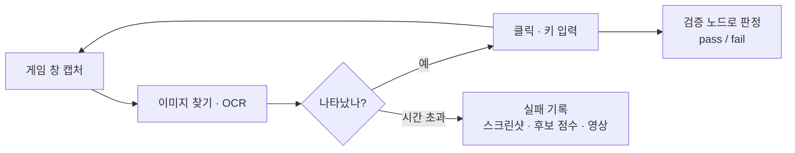
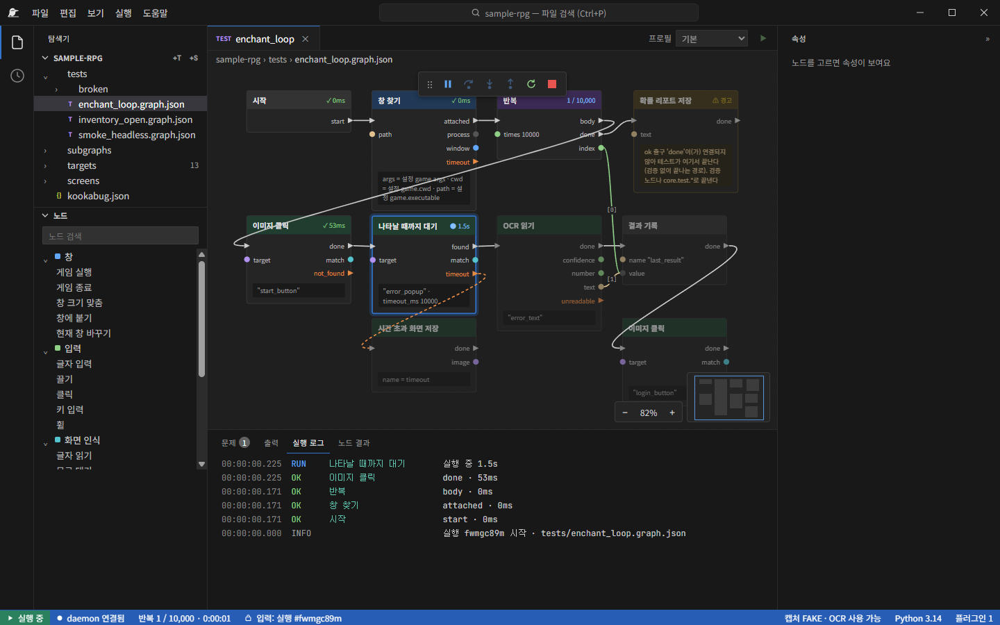
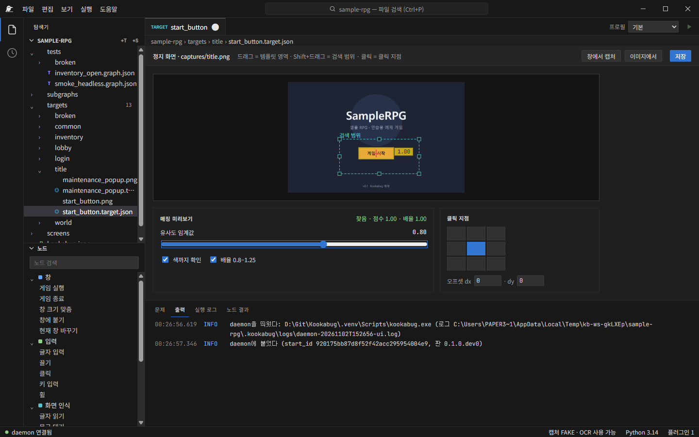
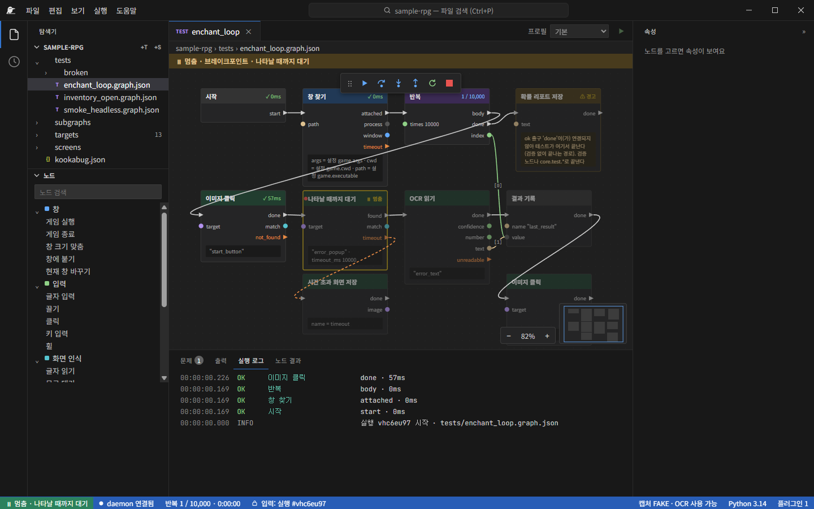
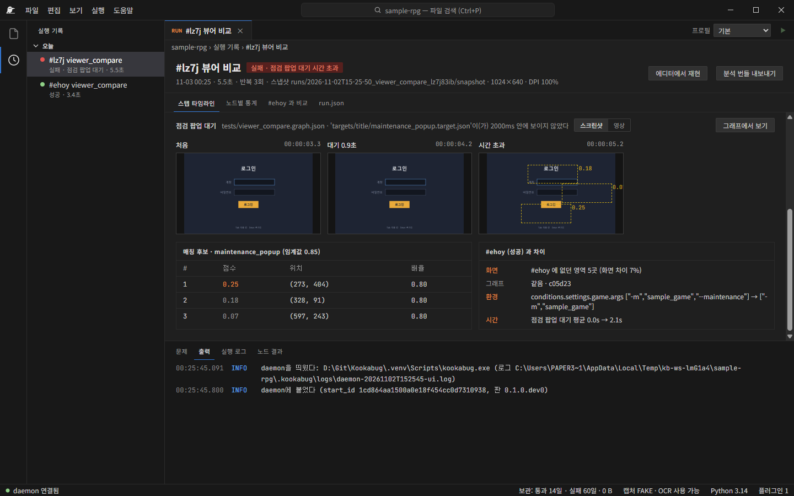
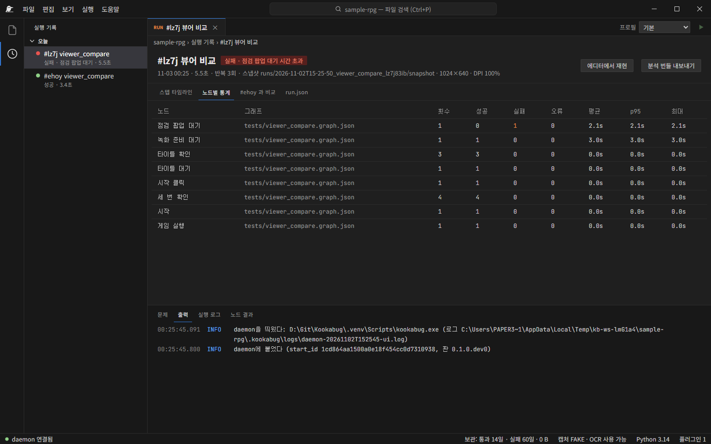
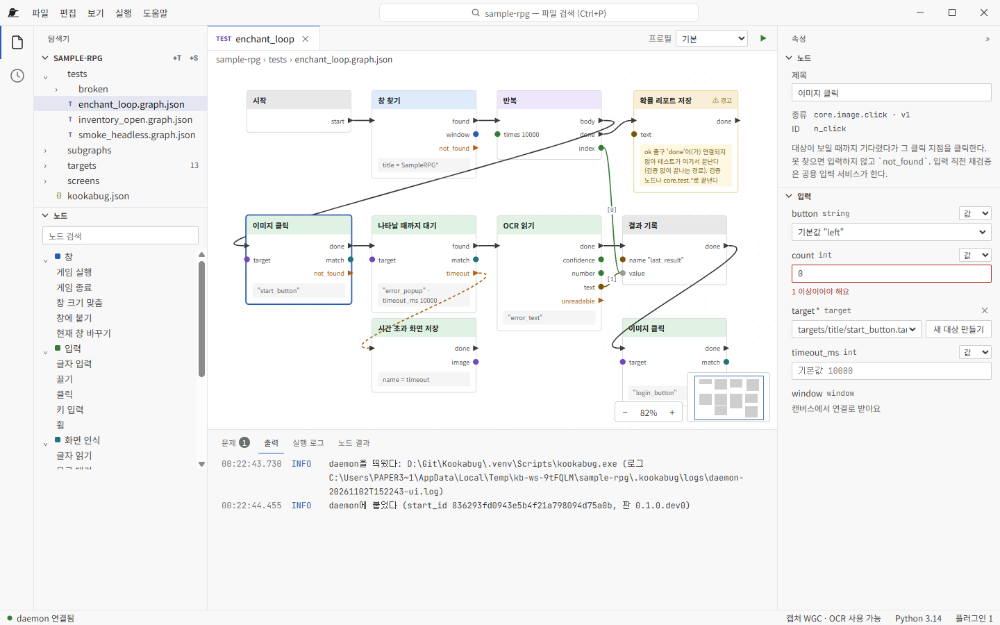
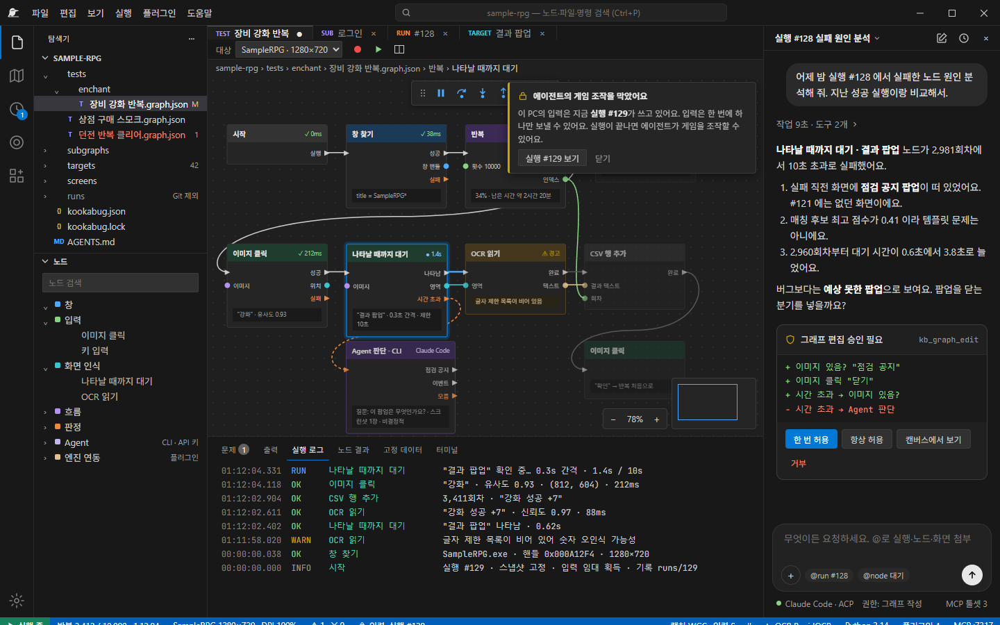
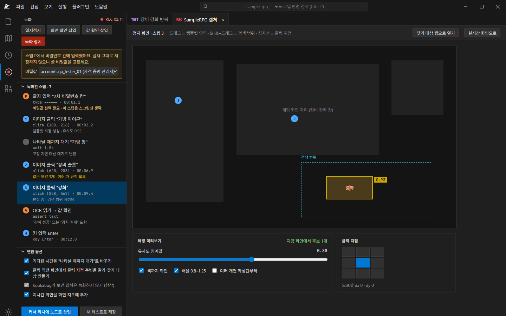

<h1 align="center">Kookabug</h1>

<b>게임 QA 자동화를 노드로 그리는 오픈소스 데스크톱 툴</b> 
게임 코드를 고치지 않고, 화면을 보고 누르는 방식으로 어떤 게임이든 자동 테스트합니다.

Windows · Apache-2.0 · 개발 중 (2026-11 기준)

---

## 한 줄 요약

QA가 **노드를 이어 테스트를 만들고**, Kookabug가 게임 창을 **캡처 → 이미지·글자 인식 → 클릭·키 입력**으로 실행합니다. 실패하면 **어디서 왜 실패했는지 스크린샷·매칭 점수·영상**이 남습니다. AI 없이도 모든 기능이 동작하고, AI 에이전트는 그 위에 붙습니다.

## 어떤 문제를 푸나

게임 QA에는 사람이 하기엔 너무 길고 지루한 반복이 많습니다.

- **확률 검증**: 상자 개봉·장비 강화를 1만 회 이상 반복하고 결과를 집계 (사람이 하면 영업일 10일 수준이라는 공개 사례가 있습니다 — NDC 넥슨 QA 발표)
- **크래시 재현**: 창 열기·닫기를 수백 번 반복
- **스모크 테스트**: 빌드마다 로그인 → 로비 → 월드 입장이 되는지 매일 확인

이걸 자동화하려 하면 보통 두 길뿐이었습니다.

1. **엔진에 테스트 코드를 넣는다** → 게임마다 개발 작업이 필요하고 QA가 직접 만들기 어렵습니다.
2. **매크로를 짠다** → 빨리 만들 수 있지만, 실패하면 *왜* 실패했는지 남지 않아 결국 사람이 다시 돌려 봐야 합니다.

대형 게임사들은 이 사이를 메우려고 **노드형 외부 매크로 툴을 사내에서 직접 만들어** 씁니다. Kookabug는 그런 툴을 **누구나 무료로 쓰고 고칠 수 있는 오픈소스**로 만들고, 실패 기록·디버거·AI 연동까지 더한 것입니다.

## 어떻게 동작하나

- **외부 매크로 방식**: 게임 엔진에 붙지 않습니다. 창을 캡처하고(WGC, GPU 화면 포함), 이미지 매칭·OCR로 화면을 읽고, 실제 하드웨어 입력(SendInput)을 보냅니다. 그래서 엔진·장르와 상관없이 같은 방식으로 씁니다.
- **기다림이 기본**: "몇 초 쉬기" 대신 "나타날 때까지 대기"가 기본이고 노드마다 제한 시간이 있습니다. 로딩이 느려져도 테스트가 덜 깨집니다.
- **테스트는 JSON 파일**: 그래프가 사람이 읽을 수 있는 JSON으로 저장되어 Git으로 관리·리뷰할 수 있습니다. 열고 아무것도 안 바꾸고 저장하면 바이트까지 같습니다.
- **CLI 무인 실행**: `kookabug run` 으로 에디터 없이 돌리고, 종료 코드(통과·실패·오류…)로 CI에 붙입니다.

## 화면으로 보기

> 아래는 레포에 들어 있는 연습용 예제 게임(SampleRPG)으로 찍은 실제 앱 화면입니다. 마지막 두 장은 개발 예정 기능의 디자인 시안입니다.

### 1. 노드 에디터 — 실행 중

"강화 1만 회 반복" 테스트를 실행하는 모습입니다. 지금 실행 중인 노드가 강조되고, 노드마다 걸린 시간·반복 횟수(1 / 10,000)가 표시됩니다. 왼쪽은 워크스페이스와 노드 팔레트, 아래는 실행 로그입니다. 실행 흐름 선(흰색)과 값 선(색)이 나뉘어 있고, 실패·시간 초과 같은 출구를 따로 이어 분기할 수 있습니다.

### 2. 찾기 대상 편집기

"게임 시작 버튼" 같은 찾을 이미지를 만듭니다. 드래그로 템플릿 영역, Shift+드래그로 검색 범위, 클릭으로 누를 지점을 정하고, 유사도 임계값을 움직이면 **지금 화면에서 매칭되는지 바로 미리 보여 줍니다** (점수 1.00).

### 3. 디버거 — 브레이크포인트에서 멈춤

코드 디버거처럼 브레이크포인트·Step Into/Over/Out·재개를 씁니다. 멈춘 동안 게임 창을 옮기거나 화면이 바뀌어도, 재개할 때 대상을 **다시 확인한 뒤에만** 입력을 보냅니다.

### 4. 기록 뷰어 — 실패 원인 분석

실패한 실행을 열면 **실패한 노드로 바로 이동**합니다. 대기 시작·중간·시간 초과 시점의 화면, 매칭 후보와 점수(가장 비슷했던 곳이 0.25 → 대상이 아예 없었다), 그리고 **지난 성공 실행과의 차이**(화면에 없던 영역, 바뀐 실행 조건, 대기 시간 변화)를 한 화면에서 봅니다. 실패한 실행은 영상도 남고, "에디터에서 재현"·"분석 번들 내보내기"로 바로 이어집니다.

### 5. 노드별 통계

반복 실행에서 노드마다 횟수·성공·실패·평균·p95·최대 시간을 집계합니다. 어느 단계가 느려지거나 가끔 실패하는지 숫자로 찾습니다.

### 6. 라이트 테마 · 속성 편집

다크·라이트 테마를 기본 제공합니다. 노드를 고르면 오른쪽에서 입력값을 편집하고, 잘못된 값은 실행 전에 바로 표시됩니다.

### 7. (시안) AI 에이전트 패널 — 개발 예정

오른쪽 패널에서 Claude Code 같은 외부 AI 에이전트에게 "어젯밤 실패 원인 분석해 줘"라고 요청합니다. 에이전트는 실행 기록을 읽어 원인을 설명하고 그래프 수정을 **제안**하며, 적용은 사람이 승인합니다. 에이전트가 할 수 있는 일은 사람이 권한 설정으로 정합니다.

### 8. (시안) 녹화기 — 개발 예정

사람이 직접 플레이하면 클릭·입력이 노드로 바뀝니다. 클릭 직전 화면에서 찾기 대상을 자동으로 만들고, 기다린 시간은 "나타날 때까지 대기"로 바꾸며, 비밀번호 입력은 글자 그대로 저장하지 않고 비밀값 참조로 바꾸게 합니다.

## 다른 도구와 무엇이 다른가

각 도구는 잘하는 영역이 다릅니다. 아래는 **"게임 QA가 직접 반복 테스트를 만들고 돌린다"** 는 목적에서 본 비교입니다.

| | **Kookabug** | 이미지 매크로 스크립트 AutoHotkey · SikuliX · PyAutoGUI 등 | 엔진 연동 테스트 엔진 자동화 프레임워크 · SDK 방식 | 업무용 RPA UiPath · Power Automate 등 | AI가 직접 플레이 컴퓨터 사용 에이전트 |
|---|---|---|---|---|---|
| 게임 코드 수정 없이 적용 | ✅ | ✅ | ❌ SDK·테스트 코드 필요 | ✅ | ✅ |
| 코딩 없이 작성 | ✅ 노드 그래프 | ❌ 스크립트 | ❌ 코드 | ✅ | ✅ 자연어 |
| 실패 원인이 남음 | ✅ 스텝별 화면·후보 점수·영상·지난 성공과 비교 | ⚠️ 직접 만들어야 함 | ⚠️ 로그 중심 | ✅ | ⚠️ |
| 같은 입력이면 같은 동작 | ✅ | ✅ | ✅ | ✅ | ❌ 매번 판단이 달라짐 |
| 게임 화면 대응 GPU 창 캡처·DPI·게임 입력 | ✅ | ⚠️ | ✅ 엔진 내부 | ⚠️ 사무 앱 UI 중심 | ⚠️ |
| 디버거 (브레이크포인트·Step) | ✅ | ❌ | ✅ | ⚠️ | ❌ |
| Git으로 관리·리뷰 | ✅ JSON | ✅ | ✅ | ⚠️ | – |
| 비용 | 무료 · 오픈소스 | 무료 | 엔진에 따라 다름 | 상용 중심 | 호출마다 모델 사용료 |

핵심 차이는 세 가지입니다.

1. **엔진에 안 붙는데도 디버깅이 된다** — 외부 매크로의 범용성과, 엔진 테스트 수준의 실패 기록·디버거를 같이 가집니다.
2. **AI는 선택, 실행은 결정적** — 테스트 실행은 항상 같은 노드 그래프를 같은 방식으로 돕니다. AI는 그래프 작성·실패 분석을 *돕는* 쪽에 있고, 실패를 몰래 자동으로 고치지 않습니다.
3. **사내 툴 수준의 기능을 오픈소스로** — 누구나 설치·수정·재배포할 수 있고(Apache-2.0), 함수 하나에 데코레이터를 붙이는 Python SDK로 새 노드를 만듭니다(플러그인 설치·배포는 M6).

## 왜 Kookabug를 써야 하나

- **사람 시간을 반복에서 빼낸다** — 수천~수만 회 반복, 매일 스모크 테스트를 밤새 기계가 돌립니다. 사람은 결과와 실패만 봅니다.
- **"다시 돌려 볼게요"가 없어진다** — 실패하면 그 순간의 화면, 무엇을 찾다가 몇 점에서 멈췄는지, 지난번 성공과 뭐가 달랐는지가 이미 남아 있습니다.
- **QA가 직접 만들고 고친다** — 프로그래머 일정을 기다리지 않습니다. 노드 그래프와 (예정) 녹화로 만들고, 찾기 대상은 화면에서 바로 확인합니다.
- **게임이 바뀌어도 그대로 쓴다** — 엔진·장르 무관. 한 게임에서 만든 로그인·접속 같은 공통 흐름을 서브그래프로 묶어 재사용합니다.
- **팀 개발 흐름에 맞는다** — 테스트가 JSON 파일이라 Git으로 리뷰하고, CLI로 CI·야간 빌드에 붙입니다.
- **AI 시대에 맞춰 설계했다** — 모든 기능을 MCP 도구로 열어, 외부 AI 에이전트가 그래프를 만들고 실패를 분석하게 할 예정입니다. 권한(무엇을 허용·질문·거부할지)은 사람이 정합니다.
- **도입 부담이 없다** — 무료, 오픈소스, 사용자별 설치(관리자 권한 불필요), Python이 없는 PC에도 설치됩니다.

## 지금 상태와 로드맵

| 단계 | 내용 | 상태 |
|---|---|---|
| M0 | 실행 엔진·판정 규칙, 기록(이벤트 JSONL·스냅샷), CLI `kookabug run` | ✅ 완료 |
| M1 | 창 캡처(WGC)·이미지 매칭·OCR(RapidOCR)·입력(SendInput), 설치 파일 | ✅ 완료 |
| M2 | 노드 에디터, 실행 전 검증 표시, 찾기 대상 편집기 | ✅ 완료 |
| M3 | 기록 뷰어(비교·통계·영상), 디버거 | ✅ 완료 |
| M4 | 녹화기 (사람 플레이 → 노드) | 🔜 다음 |
| M5 | AI 에이전트 패널, MCP 서버, Agent 판단 노드 | 예정 |
| M6 | 플러그인 설치·격리 (Python 노드 + UI 확장) | 예정 |
| M7 | 화면 지도 (에이전트 탐색 결과를 화면·이동 그래프로) | 예정 |
| MVP 검증 | 실제 게임의 스모크 테스트를 무인으로 매일 실행 | 예정 |

- 자동 테스트 3,000개 이상이 GitHub Actions CI에서 돕니다.
- 첫 버전은 **Windows만** 지원합니다. Android는 이후 adb 플러그인으로, 에뮬레이터 창은 지금도 창 캡처로 다룰 수 있습니다.
- 아직 공개 배포판은 없습니다. 소스는 이 레포에서 볼 수 있습니다.
- 기여: 구현 PR은 허용한 기여자만 받고, 버그는 재현 절차를 담은 이슈로 받습니다 → [CONTRIBUTING.md](../../CONTRIBUTING.md)

---

Kookabug · Apache-2.0 · https://github.com/paper3300/Kookabug
